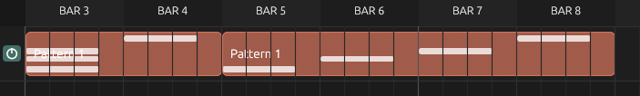

# BUGS.md

This file is a bugtracker.

# UI

## Tools

- The select hotkey S is broken.
  *Fixed: the tool hotkeys now set the arrangement tool as well as the piano-roll tool (Join still stays piano-roll only).*

## Top bar

- There is no feedback on whether the metronome is activated.
  *Fixed: the loop, metronome and pattern-play buttons now light up while active.*

## Arrangement

- When cutting, the right pattern starts at 0 again.
  *Fixed: clip previews now honour `offset_steps`, so the right-hand piece continues where the pattern was cut.*
- There is clickthrough issues when selecting a loop or clicking below the tracks.
- Enable buttons are not colored here.
- Right click and drag should delete like in the piano roll. To access the context menu, you should right click on a pattern (with a setting to turn that off) or click on its top bar (with another setting to turn that off) to access it.
  *Partly fixed: right-dragging over clips now deletes them; a stationary right-click still opens the context menu. The per-clip "top bar" affordance is still queued.*
- Selecting does not work.
  *Fixed: ctrl+click ranges resolve to entries of the same kind (they used to address notes from the clip index), a first ctrl+click now selects, and ctrl+click no longer starts a clip drag.*
  No. It appears now, but does not select anything.
  *Follow-up: selecting a pattern clip now also selects its pattern (piano roll and picker follow) and the status line names the clip. Multi-selection is drawn with the same outline/lift.*
- The selected pattern should be visibly marked.
  *Fixed: the clip picker highlights the selected pattern.*
- The cut tool should visualise where it cuts. 
  *Fixed: a dashed line marks the snapped split point in both the arrangement and the piano roll.*
- Shift clicking a clip should duplicate it. When dragging, it should follow the mouse cursor. If not, append it at the nearest free spot.
  *Partly fixed: shift+click now duplicates the clip (and selects the copy). Dragging the fresh copy mid-gesture is still queued.*
- Middle click panning should not snap. Automation clips render outside of the left bounds.
  *Partly fixed: automation clips (and their curves and points) are clipped to the grid instead of painting over the track header. Panning still snaps to steps.*
- Scrolling without a clip selected should move up or down, not zoom.
  *Fixed: a plain wheel scrolls the track rows; Ctrl+wheel zooms.*
- MIDI clips get their notes drawn on top of each other when panning.
  *Fixed: preview notes outside the clip or the visible window are skipped instead of being clamped to the window edge.*
  

## Mixer

- The volume control should be the same height as the volume meter.
  *Fixed: the strip uses a custom dB fader drawn to exactly the meter's height (the egui slider rail was inset).*
- Ctrl+Clicking the enable should solo the effect for the selected mixer track.
  *Fixed: ctrl+click on an insert's power switch solos that insert.*
  It does not. Use the same enable button struct for all enable buttons.
  *Follow-up: found the real cause — the mixer applied strip actions (enable, solo,
  lock) **after** `sync_project`, so the model changed but the engine never heard
  about it. Actions now run before the sync, so ctrl+solo and enable toggles take
  effect immediately. The shared power-switch widget is still queued.*
- The pan knob should not have any text.
  *Fixed: the mixer strip's pan knob is drawn without a label.*
- Mixer channel height should adjust to the window.
- Tracks with inserts get their empty inserts removed, making them shrink in vertical size.
  *Fixed: the strip's insert list has a fixed height, so every strip is the same size regardless of its chain.*

## Mixer routing

- The knob should be the same knob used elsewhere.
  *Fixed: the send level now uses the shared `Knob` widget (drag, alt-click reset, right-click menu, automation entry), replacing the hand-drawn circle.*

## Piano roll

- The brush tool does not brush notes but draws one continious one.
- Ctrl+Click+Drag does not select.
  *Fixed: ctrl+drag over the piano grid draws a rubber band and selects every note inside it.*
  It does not. It should be a selection box.
  *Follow-up: the band now starts on any ctrl+drag and selects every note whose body it overlaps, not just notes that start inside it.*
- Selection does not work.
  *Fixed: ctrl+click extends with a real range, and ctrl+drag box-selects notes.*
  No. Selection does not appear with either tool.
  *Follow-up: note hit-testing used the scale-snapped pitch, so with scale snap on nothing could ever be hit (the click fell through to "clear selection"). Hit tests now use the row under the pointer, the selection is reported in the status line, and the rubber band starts even when the drag begins on a note.*
- The old repeat UI is still visible.
- Repeats don't snap to whole numbers.
  *Fixed: the repeats lane maps its height to 0..32 whole repeats and rounds on drag.*
- Repeats do not give a visual indicator. There should be lines on the note showing where said note repeats.
  *Fixed: repeat boundaries are drawn as dividers inside the note.*
  Not fixed. Nothing appears.
- Ctrl+A does not work.
  *Fixed: `Ctrl+A` is now a bindable "Select all notes" action.*
- The velocity and repeat controls are not pinned to the bottom. They should be pinned and collapsible.
  *Fixed: the control lane sits under the grid (no vertical scrolling) and the "Lane" toggle collapses it.*
- Shifting notes (shift+up/down/left/right) does not work.
- Selecting a scale root note does not show the note as the root in the piano on the left.
  *Fixed: every key whose pitch class matches the scale root carries an accent stripe.*
- Short notes have a wrong selection hitbox.
- Middle click to pan does not work. UPDATE: It does work but snaps.

## Enables

- Locking an enable should not prevent it from being turned off. It should always stay on/off, regardless of the solo settings or any global operations.
  *Fixed: a direct click always flips the switch; the lock only shields it from solo and other global changes (tracks, instruments and insert slots).*

## Automation Clips

- There is jittering when zooming in/out on midi envelopes. There should be more sample points available graphically.
  *Fixed: envelopes are sampled on a fixed quarter-step grid instead of per pixel column, so zooming no longer shifts the samples.*
  Note: Add a multiplier, tweakable from settings, for substep sampling.
- LFO retriggers breaks the visualisation.
  *FIXED*
- Moving automation clips and drawing points on them causes conflicts.
  *Fixed: a clip is only grabbed by its 8 px title band and never when the press
  lands on a point, so drawing points no longer drags the clip underneath them.*
- In curve mode, no transition can be selected.
  *Fixed: right-clicking the lane now offers a transition chooser for the segment
  under the pointer ("Transition a → b", plus the clip actions that used to live
  on a separate, unreachable response), and the per-point menu names the
  incoming transition and says so plainly on the first point, which has none.*
- Sliders are not automatable.
  *Fixed: the mixer fader carries `MixerChannel { Gain }` and draws the same
  automated ring and live-value dot a knob does; right-clicking it offers
  "Add automation lane...".*
- Numeric selection boxes are not automatable.
  *Fixed: shared `automation_context_menu` helper; the BPM box now offers a
  `Tempo` lane (and the knob's ctrl+click numeric entry already did).*
- Enums are not automatable.
  *Fixed: `InstrumentParameter::Waveform` and `::ArpMode` are addressed as
  integer indices (`SignalWaveform::ALL` / `ArpMode::ALL` order), rounded when
  applied; the LFO shape is `AutomationLaneParameter::Shape`. Names are not
  shown yet, as requested.*
- Automation parameters are not automatable.
  *Fixed: `ParameterTarget::AutomationLane { track_id, parameter }` covers a
  lane's base, depth, rate amount and (for LFOs) shape, so modulation can
  modulate modulation. Right-click the Base/Depth/Rate/Shape control to add the
  lane.*
- The mixer stereo width is not automatable.
  *Fixed: `MixerParameter::Width` (0 mono to 2 double side) with a smoothed
  `lane_width` in the engine, and the strip's width knob is now a target.*

## Step sequencer

- Step sequencer buttons do not update.
  *Fixed: the rack drew step state from notes (`has_step_note`) while the buttons wrote `step_hits`, so nothing ever changed. Steps are now real C5 notes, as the README always claimed — clicking a step appears immediately in the rack and in the piano roll.*
- Changing the length messes with the piano roll pattern in weird ways. It should leave notes outside the range unaffected. 
  *Fixed: the piano roll now extends its visible range to cover every note, and clip previews no longer wrap notes that lie beyond the pattern length.*
- You cannot scroll across steps. Fix that.
  *Fixed: the mouse wheel pans the step grid (middle-drag already did).*
- If a step outside the range gets activated, it should adjust the range to include that note.
  *Fixed: painting a step beyond the pattern length grows the pattern to cover it.*
- Removing an instrument can cause crashes.
  *Fixed: MIDI routes, automation targets and `MidiEnvelope` sources are shifted (or dropped) with the instrument, so nothing indexes past the end afterwards.*
- The window layout is weird and does not scale well.

  *Improved: step columns now scale with the window (12–30 px) instead of a fixed 24 px, so the rack fills the space it is given.*
  Note: steps should overflow instead of changing size. Its rows now scale differently.
  *Fixed: back to a fixed `STEP_COLUMN_WIDTH` (24 px) so all rows line up; the rack window's scroll area handles overflow.*

## Plugin windows

- The plugin settings video is very elongated. Use a grid layout to save screen space.
  *Fixed: routing and arpeggiator sit in two columns, each a two-column grid.*
  Almost fixed. Rate and rate unit selector should be side to side.
  *Fixed: `edit_time_value` puts the value and its unit on one row.*

