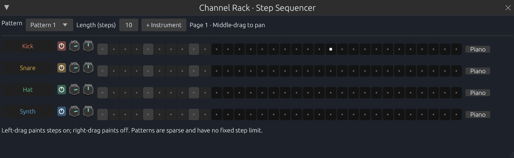

# BUGS.md

This file is a bugtracker.

# UI

## Tools

- The select hotkey S is broken.
  *Fixed: the tool hotkeys now set the arrangement tool as well as the piano-roll tool (Join still stays piano-roll only).*

## Top bar

- There is no feedback on whether the metronome is activated.
  *Fixed: the loop, metronome and pattern-play buttons now light up while active.*

## Arrangement

- There is clickthrough issues when selecting a loop or clicking below the tracks.
- Enable buttons are not colored here.
- Right click and drag should delete like in the piano roll. To access the context menu, you should right click on a pattern (with a setting to turn that off) or click on its top bar (with another setting to turn that off) to access it.
- Selecting does not work.
  *Fixed: ctrl+click ranges resolve to entries of the same kind (they used to address notes from the clip index), a first ctrl+click now selects, and ctrl+click no longer starts a clip drag.*
- The selected pattern should be visibly marked.
  *Fixed: the clip picker highlights the selected pattern.*
- The cut tool should visualise where it cuts. 
  *Fixed: a dashed line marks the snapped split point in both the arrangement and the piano roll.*
- Shift clicking a clip should duplicate it. When dragging, it should follow the mouse cursor. If not, append it at the nearest free spot.
- Middle click panning should not snap. Automation clips render outside of the left bounds.
  *Partly fixed: automation clips (and their curves and points) are clipped to the grid instead of painting over the track header. Panning still snaps to steps.*
- Scrolling without a clip selected should move up or down, not zoom.

## Mixer

- The volume control should be the same height as the volume meter.
- Ctrl+Clicking the enable should solo the effect for the selected mixer track.
  *Fixed: ctrl+click on an insert's power switch solos that insert.*
- The pan knob should not have any text.
  *Fixed: the mixer strip's pan knob is drawn without a label.*
- Mixer channel height should adjust to the window.

## Mixer routing

- The knob should be the same knob used elsewhere.

## Piano roll

- The brush tool does not brush notes but draws one continious one.
- Ctrl+Click+Drag does not select.
  *Fixed: ctrl+drag over the piano grid draws a rubber band and selects every note inside it.*
- Selection does not work.
  *Fixed: ctrl+click extends with a real range, and ctrl+drag box-selects notes.*
- The old repeat UI is still visible.
- Repeats don't snap to whole numbers.
- Repeats do not give a visual indicator. There should be lines on the note showing where said note repeats.
  *Fixed: repeat boundaries are drawn as dividers inside the note.*
- Ctrl+A does not work.
  *Fixed: `Ctrl+A` is now a bindable "Select all notes" action.*
- The velocity and repeat controls are not pinned to the bottom. They should be pinned and collapsible.
  *Fixed: the control lane sits under the grid (no vertical scrolling) and the "Lane" toggle collapses it.*
- Shifting notes (shift+up/down/left/right) does not work.
- Selecting a scale root note does not show the note as the root in the piano on the left.
- Short notes have a wrong selection hitbox.
- Middle click to pan does not work.

## Enables

- Locking an enable should not prevent it from being turned off. It should always stay on/off, regardless of the solo settings or any global operations.
  *Fixed: a direct click always flips the switch; the lock only shields it from solo and other global changes (tracks, instruments and insert slots).*

## Automation Clips

- There is jittering when zooming in/out on midi envelopes. There should be more sample points available graphically.
  *Fixed: envelopes are sampled on a fixed quarter-step grid instead of per pixel column, so zooming no longer shifts the samples.*
- LFO retriggers breaks the visualisation.
- Moving automation clips and drawing points on them causes conflicts.
- In curve mode, no transition can be selected.
- Sliders are not automatable.
- Numeric selection boxes are not automatable.
- Enums are not automatable.
- Automation parameters are not automatable.

## Step sequencer

- Step sequencer buttons do not update.
- Changing the length messes with the piano roll pattern in weird ways. It should leave notes outside the range unaffected. 
- You cannot scroll across steps. Fix that.
- If a step outside the range gets activated, it should adjust the range to include that note.
- Removing an instrument can cause crashes.
- The window layout is weird and does not scale well.

## Plugin windows

- The plugin settings video is very elongated. Use a grid layout to save screen space.
  *Fixed: routing and arpeggiator sit in two columns, each a two-column grid.*

